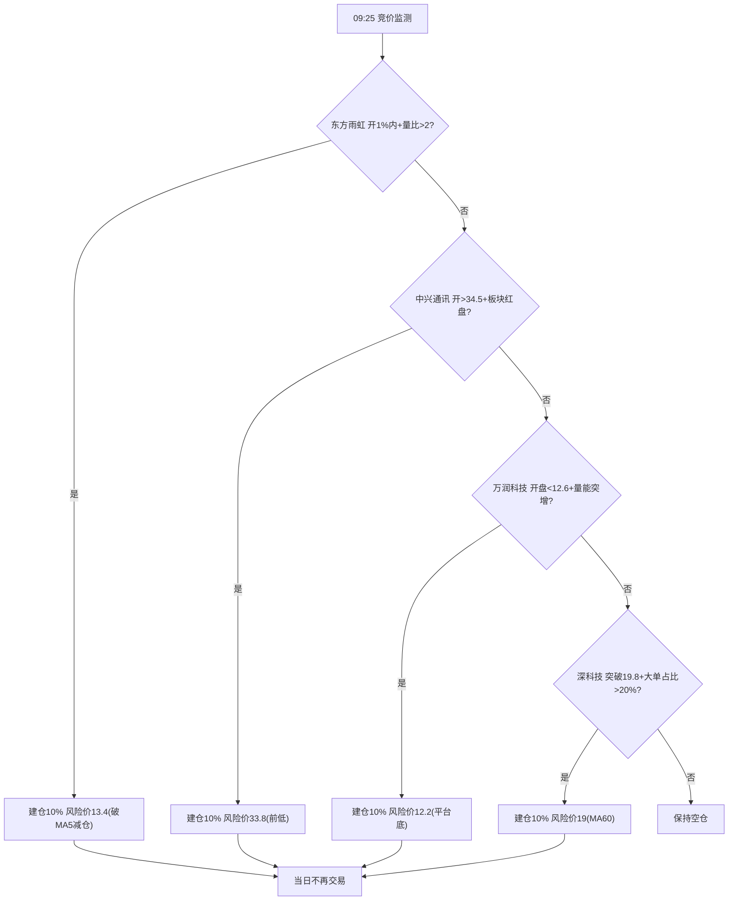

# 2025-03-28 周五

## 盘前

泰豪科技 | 动不了

中国海油 | 做 T 减仓位到 1 仓位, 盈利了换 中国石油

太阳电缆 |

紫金矿业 | 做 T, 维持 2 仓位

中国电信 | 做 T, 维持 1 仓位

纳指 ETF(159941) | 不动/清仓, 盈利了就换 纳斯达克 ETF(159632)+纳指科技 ETF(159509)

### 预期仓位

1 仓 停牌动不了

试错成本高阶段(8 仓):

| 资产类别 |                                      标的组合                                       | 仓位 | 仓数 |
| :------: | :---------------------------------------------------------------------------------: | :--: | :--: |
| 全球龙头 |             纳指 ETF(159941)/纳斯达克 ETF(159632)+纳指科技 ETF(159509)              | 20%  |  2   |
| 稳健防御 |                              三桶油(10%)+中国电信(10%)                              | 20%  |  2   |
| 周期防御 | 右侧交易超跌反弹小票(东方雨虹/中兴通讯/万润科技/深科技/上海贝岭)(10%)+紫金矿业(20%) | 30%  |  3   |
| 短线妖股 |                                    太阳电缆(20%)                                    | 20%  |  1   |
|   现金   |                                  国债逆回购(GC001)                                  | 10%  |  0   |

太阳电缆 策略:

|      情景      |               操作建议                |           逻辑依据           |
| :------------: | :-----------------------------------: | :--------------------------: |
| 竞价高开＞+3%  |       立即卖出 50%，剩余等冲高        | 诱多概率大，利用情绪反抽减亏 |
| 平开(-2%至+2%) | 观察放量阶段能否站上 7.9 元，否则清仓 |     7.9 元为套牢盘密集区     |
|   低开＞-5%    |     补仓 1 倍仓位，反弹至-3%T 出      |  利用量化程序的自动反抽机制  |

右侧交易超跌反弹小票 策略:

|   标的   | 赔率空间  |    均线系统     |        关键状态         |    资金信号     | 确定性 |     策略类型      | 优先级 |
| :------: | :-------: | :-------------: | :---------------------: | :-------------: | :----: | :---------------: | :----: |
| 东方雨虹 | 13.6-15.8 | MA60>MA55>MA20↑ | 涨价公告+站上 MA5(13.4) | 连续 3 日净流入 |  ★★★☆  |   事件驱动反弹    |   1    |
| 中兴通讯 |   34-38   | MA20>MA10>MA5↑  |   缩量企稳前低(33.5)    |  首日资金回流   |  ★★☆☆  |     技术反抽      |   2    |
| 万润科技 |  12.8-15  | MA55≈MA60(0.18) | MA5 下穿中长期线(-9.2%) |    地量企稳     |  ★★★☆  |     超跌反弹      |   3    |
|  深科技  |   19-22   | MA60>MA55>MA20↑ |   4 日站稳 MA60(19.2)   |  大单占比 38%   |  ★★☆☆  |     趋势跟随      |   4    |
| 上海贝岭 |   34-39   | MA60>MA55>MA20↓ |   缺口未补(35.2-34.8)   |  融资余额增 7%  |  ★★☆☆  | 缺口回补+业绩催化 |   5    |

### 盘前策略

## 早盘

## 下午盘

## 涨停梯队

3 板: 荣泰健康

2 板: 河化股份 凯美特气 至纯科技 华尔泰 冠石科技

## 涨停概念

### 机器人(5)

| 序号 | 股票名称(股票代码) |     涨停原因     |                                                                                                                               动因                                                                                                                                | 涨停板数  | 连续涨停数 |
| :--: | :----------------: | :--------------: | :---------------------------------------------------------------------------------------------------------------------------------------------------------------------------------------------------------------------------------------------------------------: | :-------: | :--------: |
|  1   | 荣泰健康(sh603579) |      机器人      |                                                         公司于 2025 年 3 月 13 日成立上海阿而泰机器人有限公司，经营范围包含：特殊作业机器人制造；工业机器人制造；智能机器人的研发；人工智能应用软件开发等                                                         | 3 天 3 板 |     3      |
|  2   | 振邦智能(sz003028) |      机器人      |                                                                                            2024 年 1 月 8 日公司接受调研时表示，公司目前主要布局清洁机器人、割草机器人                                                                                            |           |     1      |
|  3   | 雪龙集团(sh603949) | 间接持股宇树科技 |                                                                        雪龙集团在互动平台表示，公司作为有限合伙人通过深创投中小企业发展基金(新疆)有限合伙企业间接持股杭州宇树科技有限公司                                                                         |           |     1      |
|  4   | 福达股份(sh603166) |   核电+机器人    | 1. 公司与阿尔芬签订合资合作协议，双方共同投资设立合资公司福达阿尔芬，借助阿尔芬的技术力量、客户渠道等，共同开拓船舶、核电以及大型工程机械所需曲轴市场。 2. 公司在 2024 年半年报中透露，公司持续关注机器人零部件产业的迅速发展，在机器人减速器产品上已获得相应成果 |           |     1      |
|  5   | 新亚电缆(sz001382) |      机器人      |                                                                                        公司的主要产品为电力电缆、电气装备用电线电缆及架空导线等，机器人电缆正处于研发阶段                                                                                         |           |     1      |

### 化工(4)

| 序号 | 股票名称(股票代码) | 涨停原因  |                                                                                                                                                 动因                                                                                                                                                  | 涨停板数  | 连续涨停数 |
| :--: | :----------------: | :-------: | :---------------------------------------------------------------------------------------------------------------------------------------------------------------------------------------------------------------------------------------------------------------------------------------------------: | :-------: | :--------: |
|  1   | 河化股份(sz000953) | 化肥+甲醇 |                                                   公司主要经营范围仍为尿素、液体二氧化碳、液氨、甲醇等产品的生产与销售。尿素产品实现的营业收入占公司营业收入总额的 90％以上，液体二氧化碳、液氨、甲醇等产品实现的营业收入占公司营业收入总额约 10％                                                    | 2 天 2 板 |     2      |
|  2   |  华尔泰(sz001217)  |   硫酸    |                                                                                公司致力于化工产品的研发、生产与销售，已发展成为以合成氨、硝酸、硫酸、双氧水等基础化工产品为基础，以精细化工产品为方向的综合型化工企业                                                                                 | 2 天 2 板 |     2      |
|  3   | 光华股份(sz001333) | 业绩+IPD  | 1. 光华股份公告称，光华股份发布 2024 年年度报告摘要，公司实现营业收入 17.24 亿元，同比增长 16.48%；归属于上市公司股东的净利润 1.46 亿元，同比增长 39.10%。拟每 10 股派发现金红利 3.60 元(含税)。 2. 光华股份的主要产品包括 TGIC 固化聚酯树脂、HAA 固化聚酯树脂、IPDI 固化聚酯树脂、环氧固化聚酯树脂等 |           |     1      |
|  4   | 麦加芯彩(sh603062) | 化工+风电 |    1. 公司是一家致力于研发、生产和销售高性能多品类涂料产品的高新技术企业。公司生产的涂料按照分散介质划分，主要分为水性涂料及辅料、油性涂料及辅料和无溶剂涂料及辅料。 2. 公司风力发电设备防护涂层系列产品可以应用到风电叶片涂层防护及塔筒保护领域，目前已在国内主要风电叶片厂成功应用并且得到了认可    |           |     1      |

### 文化传媒(3)

| 序号 | 股票名称(股票代码) | 涨停原因 |                                                                                       动因                                                                                       | 涨停板数 | 连续涨停数 |
| :--: | :----------------: | :------: | :------------------------------------------------------------------------------------------------------------------------------------------------------------------------------: | :------: | :--------: |
|  1   | 上海电影(sh601595) |   影视   |           公司控股股东为上海电影(集团)有限公司，控股股东上影集团是本行业产业链最为完整的综合性影业集团之一，在制片、制作、影视基地和影视技术等领域均拥有成熟的行业经验           |          |     1      |
|  2   | 国脉文化(sz301052) |   影视   | 2021 年 12 月 21 日公告，公司于 2021 年 2 月 9 日与亭东影业在公司会议室签署《电影投资合作协议》，投资 1300 万元购买新电影 5%投资份额。截至目前，该片已经拍摄完成，定名为《四海》 |          |     1      |
|  3   | 新华文轩(sh601811) |   出版   |                                                       公司是我国第一家按照上市公众公司标准规范设立的大型股份制出版发行企业                                                       |          |     1      |

### 核电(3)

| 序号 | 股票名称(股票代码) |  涨停原因   |                                                                                                                   动因                                                                                                                    | 涨停板数  | 连续涨停数 |
| :--: | :----------------: | :---------: | :---------------------------------------------------------------------------------------------------------------------------------------------------------------------------------------------------------------------------------------: | :-------: | :--------: |
|  1   | 合锻智能(sh603011) | 核聚变+算力 | 1. 公司核聚变业务主要致力于解决聚变堆复杂部件的研发制造，已经参与了聚变堆、真空室、偏滤器等核心部件的制造预研工作。 2. 公司基于国内外一线 AI 芯片厂家的产品，打造自己的专用硬件算力平台，在平台支撑下自主研发并部署传统算法及 AI 专用算法 |           |     1      |
|  2   | 雪人股份(sz002639) | 可控核聚变  |                                                 公司已为中科院合肥物质研究所、理化所等多所研究院提供氦气螺杆压缩机，分别应用于全超导托克马克核聚变实验装置、航天试验等大科学工程应用领域                                                  | 4 天 2 板 |     1      |
|  3   |  哈空调(sh600202)  |    核电     |                                  公司从事的主营业务为各种高、中、低压空冷器的设计、制造和销售。主要产品包括石化空冷器和电站空冷器。此外，公司还设计、制造和销售核电站空气处理机组产品及其他工业空调产品                                   |           |     1      |

### 芯片产业链(3)

| 序号 | 股票名称(股票代码) |  涨停原因  |                                                                             动因                                                                             | 涨停板数  | 连续涨停数 |
| :--: | :----------------: | :--------: | :----------------------------------------------------------------------------------------------------------------------------------------------------------: | :-------: | :--------: |
|  1   | 凯美特气(sz002549) |   光刻气   |                                                    公司光刻气产品通过 ASML 子公司 Cymer 的合格供应商认证                                                     | 2 天 2 板 |     2      |
|  2   | 冠石科技(sh605588) | 半导体材料 |   公司主营业务为半导体显示器件及特种胶粘材料的研发、生产和销售，其中半导体显示器件包括偏光片、功能性器件、信号连接器、液晶面板、生产辅耗材及 OCA 光学胶等    | 2 天 2 板 |     2      |
|  3   | 至纯科技(sh603690) | 半导体设备 | 公司是国内主流气体化学品相关的高纯工艺系统及半导体装备的合格供应商，高纯工艺系统产品主要包括气体高纯工艺设备及系统、化学品高纯工艺设备及系统以及物料及水系统 | 2 天 2 板 |     2      |

### 光伏(3)

| 序号 | 股票名称(股票代码) |  涨停原因   |                                                        动因                                                        | 涨停板数 | 连续涨停数 |
| :--: | :----------------: | :---------: | :----------------------------------------------------------------------------------------------------------------: | :------: | :--------: |
|  1   | 欧晶科技(sz001269) | 光伏+半导体 | 公司主要产品为直拉单晶硅用电弧石英坩埚，产品主要应用于光伏和半导体领域，可支持太阳能和半导体用户高温条件下连续拉晶 |          |     1      |
|  2   | 森特股份(sh603098) |    光伏     |                公司主要致力于光伏系统、光伏电站项目的投资、开发、设计、销售、系统运行维护、售后服务                |          |     1      |
|  3   | 恒星科技(sz002132) |    光伏     |                 公司目前在光伏领域涉及太阳能光伏用多晶硅片产品及切割多(单)晶硅片的超精细金刚线产品                 |          |     1      |

### 医药(1)

| 序号 | 股票名称(股票代码) |     涨停原因      |                                                                                                               动因                                                                                                               | 涨停板数 | 连续涨停数 |
| :--: | :----------------: | :---------------: | :------------------------------------------------------------------------------------------------------------------------------------------------------------------------------------------------------------------------------: | :------: | :--------: |
|  1   | 四环生物(sz000518) | 医疗器械+细胞治疗 | 1. 公司是一家以生物医学技术及传统医药相结合的药品生产企业，主营肝炎诊断试剂、注射剂、体外诊断试剂等。 2. 2023 年公司研发项目包括新型干细胞培养技术，目的为通过对干细胞培养技术的研究，以期在未来将干细胞技术应用于人类疾病的治疗 |          |     1      |

### 稀土永磁(1)

| 序号 | 股票名称(股票代码) |   涨停原因    |                                                                                                                                     动因                                                                                                                                      | 涨停板数 | 连续涨停数 |
| :--: | :----------------: | :-----------: | :---------------------------------------------------------------------------------------------------------------------------------------------------------------------------------------------------------------------------------------------------------------------------: | :------: | :--------: |
|  1   | 华宏科技(sz002645) | 稀土+汽车拆解 | 1. 公司旗下全资子公司鑫泰科技主营业务为稀土废料的综合利用，即通过钕铁硼废料、荧光粉废料生产高纯稀土氧化物，其全资子公司中杭新材从事稀土永磁材料生产业务。 2. 公司是再生资源加工装备专业制造商和综合服务提供商，再生资源运营业务主要以废钢加工、贸易和报废汽车综合回收利用为主 |          |     1      |

### 算力工程(1)

| 序号 | 股票名称(股票代码) | 涨停原因 |                                                                                                                               动因                                                                                                                               | 涨停板数 | 连续涨停数 |
| :--: | :----------------: | :------: | :--------------------------------------------------------------------------------------------------------------------------------------------------------------------------------------------------------------------------------------------------------------: | :------: | :--------: |
|  1   | 大位科技(sh600589) |   算力   | 公司聚焦主业完成由数据中心、云计算中心向算力中心的业务转型，张北算力中心项目位于国家八大算力枢纽之一的张家口算力集群。公司将在算力基础设施建设运营的基础上，向客户提供垂直算力服务，并基于国家八大算力枢纽建设主算力节点，结合边缘算力开展云网一体化垂直算力服务 |          |     1      |

### ST 股(3)

| 序号 | 股票名称(股票代码)  | 涨停原因 |                                               动因                                               | 涨停板数 | 连续涨停数 |
| :--: | :-----------------: | :------: | :----------------------------------------------------------------------------------------------: | :------: | :--------: |
|  1   | \*ST 九有(sh600462) |  ST 股   |                         公司原主营新闻纸、商品木浆、胶版纸等的生产与销售                         |          |     1      |
|  2   |  ST 恒久(sz002808)  |  ST 股   | 公司的控股子公司福建省闽保信息技术有限公司是一家从事信息安全领域软件开发及系统集成的高新技术企业 |          |     1      |
|  3   |  ST 花王(sh603007)  |  ST 股   | 公司是一家集园林景观、市政工程、河湖整治、生态治理、文体文旅等多领域业务于一体的生态工程建设企业 |          |     1      |

### 其他(8)

| 序号 | 股票名称(股票代码) |   涨停原因   |                                                                                               动因                                                                                                | 涨停板数  | 连续涨停数 |
| :--: | :----------------: | :----------: | :-----------------------------------------------------------------------------------------------------------------------------------------------------------------------------------------------: | :-------: | :--------: |
|  1   | 和顺石油(sh603353) |   华为超充   | 2023 年 11 月 24 日公司在官网披露，公司与华为数字能源技术有限公司、深圳市新顺能科技有限公司签署三方战略合作协议，三方会基于智能超快充数据技术，并融合 AI 等新技术应用，共同合作智能超快充数据平台 | 3 天 2 板 |     1      |
|  2   | 润都股份(sz002923) |     烟碱     |                                                      子公司润都制药(荆门)有限公司生产的电子烟用烟碱品质获得客户普遍认可，并已形成商业化销售                                                       | 4 天 2 板 |     1      |
|  3   | 天普股份(sh605255) |  汽车零部件  |             公司主营产品为汽车用高分子材料流体管路系统及密封系统零件及总成，目前与全球日产、吉利汽车、一汽轿车、江铃汽车等客户合作开发其新能源车型产品，配套产品以橡胶管与总成管为主              |           |     1      |
|  4   | 西部黄金(sh601069) |     黄金     |                               公司主营业务为黄金采选及冶炼，同时从事铬矿石的开采。公司主要产品包括黄金、铬矿石、铁矿石，其中黄金是公司最主要的产品和最主要收入来源                                |           |     1      |
|  5   | 新力金融(sh600318) |   多元金融   |                                             实际控制人为安徽省供销合作社联合社。公司以农村金融服务为特色，以互联网金融为核心的综合性现代金融服务企业                                              |           |     1      |
|  6   | 德尔未来(sz002631) |     地板     |             国内地板龙头之一，2017 年完善了地板强化、实木复合、实木的全品类系列，逐步完善全屋空间定制(板、衣柜、橱柜、木门、软装等)，整合研发、销售网络、安装服务满足消费者差异化需求             |           |     1      |
|  7   | 云南城投(sh600239) |    房地产    |                                                公司经营范围涵盖房地产开发与经营、商品房销售、房屋租赁、基础设施建设投资、土地开发、项目投资与管理                                                 |           |     1      |
|  8   | 永利股份(sz300230) | 精密模塑产品 |                                                                   公司精密模塑产品包含智能家居产品配件、智能益智教育产品配件等                                                                    |           |     1      |

## 复盘

### 泰豪科技 | 数据中心应急电源(02/24)+数据中心电力(02/21)+数据中心电源(02/20)

### 中国海油 | 沪深 300+上证 180+石油行业板块

2 仓位

### 中国电信 | 上证 50+沪深 300 通信服务板块+国资云(02/21)

2 仓位

### 紫金矿业 | 上证 50+沪深 300 有色金属板块

2 仓位

### 长江电力 | 上证 50+沪深 300 电力行业板块

1 仓位

### 山东黄金 | 沪深 300+上证 180+贵金属板块

1 仓位

### 复盘持仓

### 龙虎榜

#### 概况

上榜 65 只(75 条记录); 机构净买前三: 回盛生物 +2.12亿、永贵转债 +1.22亿、\*ST华西 +9724万; 机构净卖前三: 深城交 -2.17亿、新莱应材 -1.16亿、大丰实业 -6266万; 北向净买最多: 湖北宜化 +7901万; 北向净卖最多: 中信重工 -1315万; 游资: 拉萨团结路第一证券营业部×21 拉萨东环路第二证券营业部×18 拉萨金融城南环路证券营业部×17 拉萨团结路第二证券营业部×14 拉萨东环路第一证券营业部×6 章盟主×5 炒股养家×5 山东帮×3 宁波桑田路×3 作手新一×2 陈小群×2 消闲派×1

| 股票 | 上榜原因 | 涨跌 | 买入 | 卖出 | 净额 | 机构 | 游资 |
| :--: | :------: | :--: | :--: | :--: | :--: | :--: | :--: |
| 雪人集团 002639 | 换手20%; 涨幅偏离7% | +9.99% | 2.80亿 | 1.32亿 | +1.49亿 | - | 章盟主+4006万 拉萨团结路第一证券营业部-1599万 拉萨东环路第二证券营业部-1335万 |
| 永贵转债 123253 | 可转债上市首日 | +24.16% | 3.13亿 | 1.86亿 | +1.26亿 | +1.22亿(3买) | - |
| 新亚电缆 001382 | 换手20%; 涨幅偏离7% | +10.00% | 1.55亿 | 3751万 | +1.17亿 | +4610万(2买) | 拉萨东环路第一证券营业部-460万 拉萨东环路第二证券营业部-380万 |
| 合锻智能 603011 | 涨幅偏离7%; 换手20% | +10.04% | 2.61亿 | 1.62亿 | +9849万 | -4117万(1卖) | 作手新一+6135万 章盟主+5320万 拉萨团结路第一证券营业部-2646万 拉萨东环路第二证券营业部-2309万 |
| 天和磁材 603072 | 换手20% | -3.55% | 1.97亿 | 1.09亿 | +8766万 | - | 山东帮-1332万 |
| 华宏科技 002645 | 涨幅偏离7% | +10.00% | 1.31亿 | 5954万 | +7129万 | -66.3万(2买3卖) | 山东帮+2221万 |
| 永利股份 300230 | 涨幅15%; 换手30% | +20.04% | 1.71亿 | 1.02亿 | +6974万 | -381万(1卖) | 作手新一+4174万 章盟主+3090万 |
| \*ST皇庭 000056 | 振幅15% | +4.01% | 1.24亿 | 6545万 | +5883万 | +312万(2买3卖) | 拉萨团结路第二证券营业部-335万 |
| 邵阳液压 301079 | 换手30% | -5.48% | 1.66亿 | 1.08亿 | +5843万 | +1874万(2买3卖) | 拉萨东环路第二证券营业部-484万 拉萨团结路第二证券营业部-333万 |
| 鲁抗医药 600789 | 换手20% | -3.68% | 2.84亿 | 2.31亿 | +5297万 | - | 拉萨团结路第一证券营业部+2792万 |
| 至纯科技 603690 | 3日涨幅偏离20% | +10.00% | 3.00亿 | 2.51亿 | +4950万 | -4600万(1卖) | 陈小群+6338万 |
| 大位科技 600589 | 涨幅偏离7% | +10.05% | 2.65亿 | 2.16亿 | +4933万 | - | 拉萨团结路第一证券营业部-2263万 拉萨金融城南环路证券营业部-2016万 |
| 冠石科技 605588 | 3日涨幅偏离20% | +10.01% | 1.10亿 | 6278万 | +4703万 | - | - |
| ST云城 600239 | 涨幅偏离7% | +10.08% | 6290万 | 1669万 | +4620万 | - | - |
| 果麦文化 301052 | 涨幅15% | +20.00% | 1.24亿 | 8212万 | +4222万 | +1572万(3买4卖) | - |
| 凯美特气 002549 | 3日涨幅偏离20% | +10.00% | 7045万 | 3073万 | +3972万 | - | 章盟主+1366万 拉萨金融城南环路证券营业部-118万 |
| 哈空调 600202 | 涨幅偏离7% | +10.10% | 6942万 | 4088万 | +2854万 | -567万(1卖) | - |
| 常辅股份 920396 | 振幅30%; 换手20% | +18.10% | 6829万 | 4073万 | +2755万 | - | 拉萨团结路第二证券营业部-396万 拉萨团结路第一证券营业部-202万 |
| 恒星科技 002132 | 涨幅偏离7% | +10.06% | 6774万 | 4271万 | +2503万 | -2345万(4卖) | 炒股养家+993万 |
| 佛山照明 000541 | 跌幅偏离7% | -10.02% | 1.09亿 | 8558万 | +2358万 | +3161万(3买1卖) | 拉萨金融城南环路证券营业部-461万 |
| 翰博高新 301321 | 涨幅15% | +16.77% | 7764万 | 5456万 | +2308万 | - | - |
| 鲁北化工 600727 | 跌幅偏离7% | -10.04% | 8642万 | 6404万 | +2239万 | - | 拉萨金融城南环路证券营业部-969万 拉萨东环路第二证券营业部-862万 拉萨团结路第一证券营业部-853万 |
| 众业达 002441 | 振幅15% | -4.92% | 5183万 | 3467万 | +1716万 | +1174万(2买1卖) | - |
| 迪尔化工 920304 | 换手20% | -15.68% | 4798万 | 3172万 | +1626万 | - | 拉萨东环路第二证券营业部+113万 拉萨团结路第二证券营业部-85.1万 拉萨金融城南环路证券营业部-251万 |
| 江天化学 300927 | 跌幅15% | -15.68% | 7743万 | 6552万 | +1191万 | +2221万(3买1卖) | 拉萨东环路第二证券营业部+339万 拉萨团结路第二证券营业部+12.5万 |
| 荣泰健康 603579 | 涨幅偏离7% | +10.02% | 4676万 | 3625万 | +1051万 | -715万(1卖) | - |
| 巨力索具 002342 | 换手20% | +5.89% | 1.88亿 | 1.83亿 | +487万 | +253万(1买1卖) | 拉萨金融城南环路证券营业部+2488万 拉萨团结路第一证券营业部-27.0万 宁波桑田路-1895万 |
| 炬申股份 001202 | 3日跌幅偏离20% | -4.09% | 4507万 | 4373万 | +134万 | +1379万(2买) | 拉萨东环路第二证券营业部-127万 拉萨团结路第一证券营业部-225万 |
| 中毅达B 900906 | 跌幅偏离7% | -10.10% | 86.0万 | 65.3万 | +20.7万 | - | 章盟主+39.0万 |
| 回盛生物 300871 | 3日涨幅偏离30%; 涨幅偏离100%; 涨幅15% | +19.05% | 22.19亿 | 22.19亿 | 0 | +2.12亿(1买1卖) | - |
| \*ST嘉寓 300117 | 跌幅15%; 3日跌幅偏离30% | -20.59% | 94.1万 | 112万 | -18.1万 | - | - |
| 克莱特 920689 | 换手20% | -9.44% | 5133万 | 5162万 | -29.5万 | - | 拉萨团结路第二证券营业部-323万 拉萨东环路第二证券营业部+222万 拉萨团结路第一证券营业部+239万 拉萨东环路第一证券营业部+28.6万 |
| \*ST富润 600070 | 3日跌幅偏离12% | -4.62% | 165万 | 201万 | -35.4万 | -45.1万(1卖) | 拉萨金融城南环路证券营业部+18.1万 |
| 苏利股份 603585 | 跌幅偏离7% | -10.02% | 3481万 | 3566万 | -85.2万 | - | 炒股养家-667万 |
| \*ST沐邦 603398 | 跌幅偏离7% | -10.01% | 3812万 | 3966万 | -154万 | - | - |
| 华尔泰 001217 | 3日涨幅偏离20%; 涨幅偏离7% | +9.99% | 1.15亿 | 1.19亿 | -403万 | -1054万(1卖) | - |
| \*ST元成 603388 | 3日涨幅偏离12% | +3.49% | 1916万 | 2424万 | -508万 | - | - |
| 同惠电子 920509 | 换手20% | +8.26% | 7091万 | 7604万 | -513万 | - | 拉萨团结路第二证券营业部-105万 拉萨团结路第一证券营业部+514万 拉萨东环路第二证券营业部+406万 拉萨东环路第一证券营业部+202万 |
| 合金投资 000633 | 振幅15% | -5.36% | 4077万 | 4676万 | -599万 | -115万(1买2卖) | 拉萨东环路第一证券营业部+366万 |
| 大连重工 002204 | 跌幅偏离7% | -9.99% | 2.21亿 | 2.29亿 | -755万 | +85.7万(2买1卖) | 消闲派-4980万 |
| ST新元 300472 | 跌幅15% | -20.00% | 424万 | 1321万 | -897万 | +112万(2买) | - |
| ST标准 600302 | 振幅15% | -9.64% | 3641万 | 4972万 | -1331万 | - | 拉萨金融城南环路证券营业部+645万 |
| 新莱应材 300260 | 换手30%; 3日涨幅偏离30% | +14.45% | 3.76亿 | 3.90亿 | -1441万 | -1.16亿(1买2卖) | 拉萨东环路第二证券营业部+3819万 拉萨团结路第二证券营业部+2778万 |
| 常青科技 603125 | 换手20% | -1.47% | 3784万 | 5461万 | -1678万 | -645万(1卖) | 炒股养家+979万 拉萨团结路第一证券营业部-192万 拉萨金融城南环路证券营业部+476万 拉萨东环路第二证券营业部+449万 |
| 三维装备 920834 | 换手20% | -15.56% | 1356万 | 3109万 | -1753万 | - | 拉萨团结路第二证券营业部-17.5万 拉萨东环路第二证券营业部+54.8万 拉萨团结路第一证券营业部-205万 |
| 中哲精化 000953 | 3日涨幅偏离20% | +10.00% | 5797万 | 7617万 | -1820万 | -608万(1买2卖) | - |
| 工智退 000584 | 3日跌幅偏离12% | -4.92% | 2108万 | 3935万 | -1827万 | +135万(1买) | 拉萨金融城南环路证券营业部+161万 拉萨团结路第一证券营业部-298万 |
| \*ST三房 600370 | 振幅15% | -5.16% | 2331万 | 4171万 | -1840万 | - | 拉萨金融城南环路证券营业部+664万 拉萨东环路第一证券营业部+435万 拉萨团结路第一证券营业部+394万 拉萨团结路第二证券营业部-654万 |
| 湖北宜化 000422 | 跌幅偏离7% | -9.97% | 3.01亿 | 3.19亿 | -1863万 | +5967万(2买) | - |
| 键邦股份 603285 | 换手20% | -10.00% | 3657万 | 5590万 | -1933万 | - | - |
| \*ST东方 600811 | 3日跌幅偏离12% | -4.92% | 607万 | 2817万 | -2211万 | - | 拉萨金融城南环路证券营业部+143万 拉萨团结路第二证券营业部+126万 拉萨东环路第二证券营业部+119万 拉萨东环路第一证券营业部+106万 |
| 尤夫股份 002427 | 振幅15% | -9.94% | 7442万 | 9824万 | -2382万 | -1112万(1卖) | 拉萨团结路第一证券营业部+489万 拉萨金融城南环路证券营业部+554万 宁波桑田路-761万 |
| 中毅达 600610 | 跌幅偏离7% | -10.03% | 7440万 | 1.07亿 | -3244万 | - | 拉萨金融城南环路证券营业部+1355万 拉萨团结路第一证券营业部-44.7万 陈小群-3624万 |
| 久盛电气 301082 | 换手30% | +10.51% | 5817万 | 9260万 | -3443万 | -3500万(3买3卖) | - |
| 先锋电子 002767 | 3日跌幅偏离20% | -9.99% | 8053万 | 1.22亿 | -4157万 | -458万(1买1卖) | 拉萨东环路第二证券营业部+295万 拉萨团结路第一证券营业部+217万 |
| 国林科技 300786 | 换手30% | +1.74% | 5485万 | 1.09亿 | -5413万 | -3298万(2卖) | 拉萨团结路第二证券营业部+32.2万 拉萨团结路第一证券营业部+547万 拉萨东环路第二证券营业部+422万 |
| 南方精工 002553 | 跌幅偏离7% | -9.98% | 8986万 | 1.47亿 | -5671万 | +562万(1买) | 炒股养家+2267万 拉萨团结路第一证券营业部+571万 拉萨金融城南环路证券营业部+314万 |
| 富岭股份 001356 | 换手20% | -3.16% | 6252万 | 1.26亿 | -6334万 | -77.6万(2买) | 宁波桑田路-2521万 |
| 汉邦高科 300449 | 跌幅15% | -19.97% | 3602万 | 1.05亿 | -6938万 | -4668万(3卖) | 拉萨东环路第二证券营业部+530万 拉萨团结路第二证券营业部+349万 |
| 中信重工 601608 | 跌幅偏离7% | -10.07% | 1.25亿 | 2.00亿 | -7490万 | - | 拉萨金融城南环路证券营业部-865万 |
| \*ST华西 002630 | 跌幅偏离7% | -9.91% | 1.50亿 | 2.52亿 | -1.01亿 | +9724万(5买1卖) | - |
| 大丰实业 603081 | 3日跌幅偏离20% | -9.96% | 1.58亿 | 2.73亿 | -1.15亿 | -6266万(1卖) | 炒股养家+2843万 山东帮-2313万 |
| 红宝丽 002165 | 换手20% | +1.35% | 1.41亿 | 2.78亿 | -1.36亿 | -5240万(2卖) | 拉萨东环路第二证券营业部+489万 拉萨金融城南环路证券营业部+490万 拉萨团结路第一证券营业部+504万 |
| 深城交 301091 | 跌幅15% | -17.49% | 1.39亿 | 2.82亿 | -1.43亿 | -2.17亿(1卖) | 拉萨团结路第二证券营业部+693万 |
| 电投产融 000958 | 3日涨幅偏离20% | +6.49% | 4.37亿 | 8.41亿 | -4.04亿 | - | 拉萨团结路第一证券营业部+881万 |

原始数据: downloads/lhb/2025.03.28/(东财 datacenter-web; 主记录=当日口径, 只有 3 日累计榜时用 3 日数据; 买入/卖出/净额=买五卖五合计, 机构/游资=买五卖五去重后净额, 机构括号=在买五/卖五里出现的次数)

#### 雪人集团 002639

- 上榜: 换手20%; 涨幅偏离7% · 涨跌 +9.99% · 成交额 18.20亿 · 净额 +1.49亿(买 2.80亿 卖 1.32亿)
- 买: 国泰君安 上海新闸路 7418万 / 深股通专用 6059万 / 国泰君安 上海江苏路(章盟主) 4048万 / 开源 西安西大街 4011万 / 华宝 上海东大名路 3376万
- 卖: 申万宏源 上海静安区康定路 3016万 / 中信建投 长乐吴航路 2947万 / 东方财富 拉萨团结路第一(拉萨天团) 2698万 / 深股通专用 2224万 / 东方财富 拉萨东环路第二(拉萨天团) 2209万

#### 永贵转债 123253

- 上榜: 可转债上市首日 · 涨跌 +24.16% · 成交额 9.17亿 · 净额 +1.26亿(买 3.13亿 卖 1.86亿)
- 买: 光大 深圳金田路 7358万 / 机构专用 4594万 / 光大 深圳深湾一路 3836万 / 机构专用 3818万 / 机构专用 3756万
- 卖: 光大 深圳金田路 7282万 / 光大 惠州淡水 3621万 / 光大 深圳深湾一路 3462万 / 华宝 上海东大名路 2630万 / 华鑫 上海分公司 1638万

#### 新亚电缆 001382

- 上榜: 换手20%; 涨幅偏离7% · 涨跌 +10.00% · 成交额 6.83亿 · 净额 +1.17亿(买 1.55亿 卖 3751万)
- 买: 中信 杭州凤起路 4228万 / 开源 西安西大街 3786万 / 机构专用 3176万 / 中信 杭州文三路 1758万 / 机构专用 1434万
- 卖: 长江 杭州秋涛北路 862万 / 东莞 常熟东南大道 823万 / 东方财富 拉萨东环路第一(拉萨天团) 702万 / 东方 福州五四路 656万 / 东方财富 拉萨东环路第二(拉萨天团) 624万

#### 合锻智能 603011

- 上榜: 涨幅偏离7%; 换手20% · 涨跌 +10.04% · 成交额 24.52亿 · 净额 +9849万(买 2.61亿 卖 1.62亿)
- 买: 长江 昆明白龙路 6706万 / 国泰君安 南京太平南路(作手新一) 6135万 / 国泰君安 上海江苏路(章盟主) 5320万 / 高盛(中国) 上海浦东新区世纪大道 4343万 / 摩根大通(中国) 上海银城中路 3589万
- 卖: 摩根大通(中国) 上海银城中路 4776万 / 机构专用 4117万 / 东方财富 拉萨团结路第一(拉萨天团) 2646万 / 开源 西安西大街 2395万 / 东方财富 拉萨东环路第二(拉萨天团) 2309万

#### 天和磁材 603072

- 上榜: 换手20% · 涨跌 -3.55% · 成交额 11.75亿 · 净额 +8766万(买 1.97亿 卖 1.09亿)
- 买: 国泰君安 总部 7282万 / 高盛(中国) 上海浦东新区世纪大道 4749万 / 瑞银 上海浦东新区花园石桥路第二 3514万 / 财通 温岭中华路 2234万 / 摩根大通(中国) 上海银城中路 1928万
- 卖: 中信 上海分公司 2913万 / 中国国际金融 上海分公司 2423万 / 高盛(中国) 上海浦东新区世纪大道 2307万 / 国泰君安 总部 1966万 / 东方 厦门仙岳路(山东帮) 1332万

#### 华宏科技 002645

- 上榜: 涨幅偏离7% · 涨跌 +10.00% · 成交额 5.26亿 · 净额 +7129万(买 1.31亿 卖 5954万)
- 买: 开源 西安西大街 4001万 / 东方 厦门仙岳路(山东帮) 3329万 / 机构专用 1436万 / 华鑫 深圳分公司 1236万 / 机构专用 1038万
- 卖: 机构专用 1923万 / 东方 厦门仙岳路(山东帮) 1108万 / 机构专用 863万 / 兴业 厦门湖里大道 862万 / 机构专用 714万

#### 永利股份 300230

- 上榜: 涨幅15%; 换手30% · 涨跌 +20.04% · 成交额 13.89亿 · 净额 +6974万(买 1.71亿 卖 1.02亿)
- 买: 国泰君安 南京太平南路(作手新一) 4207万 / 兴业 厦门湖里大道 3359万 / 国泰君安 上海海阳西路(章盟主) 3090万 / 中信 杭州凤起路 2897万 / 东海 福州长乐北路 2306万
- 卖: 华泰 重庆江北嘴 4375万 / 中天 沈阳十三纬路 1492万 / 方正 台州解放路 1485万 / 机构专用 1383万 / 华鑫 上海金山 1341万

#### \*ST皇庭 000056

- 上榜: 振幅15% · 涨跌 +4.01% · 成交额 6.38亿 · 净额 +5883万(买 1.24亿 卖 6545万)
- 买: 长城 长沙五一中路 3600万 / 机构专用 2513万 / 招商 深圳深南大道车公庙 2244万 / 华泰 绍兴府山 1961万 / 机构专用 963万
- 卖: 机构专用 2070万 / 机构专用 1133万 / 财信 长沙湘江中路 711万 / 机构专用 709万 / 东方财富 拉萨团结路第二(拉萨天团) 693万

#### 邵阳液压 301079

- 上榜: 换手30% · 涨跌 -5.48% · 成交额 9.11亿 · 净额 +5843万(买 1.66亿 卖 1.08亿)
- 买: 机构专用 5112万 / 机构专用 2695万 / 中信 北京安外大街 2325万 / 中国国际金融 上海分公司 1797万 / 中国银河 北京中关村大街 1336万
- 卖: 机构专用 4687万 / 机构专用 1541万 / 东方财富 拉萨东环路第二(拉萨天团) 1232万 / 机构专用 1193万 / 东方财富 拉萨团结路第二(拉萨天团) 911万

#### 鲁抗医药 600789

- 上榜: 换手20% · 涨跌 -3.68% · 成交额 27.92亿 · 净额 +5297万(买 2.84亿 卖 2.31亿)
- 买: 沪股通专用 1.51亿 / 中国国际金融 上海分公司 4088万 / 中信 上海分公司 3842万 / 东方财富 拉萨团结路第一(拉萨天团) 2792万 / 信达 深圳湾科技生态园 2550万
- 卖: 沪股通专用 9607万 / 湘财 南京水西门大街 4399万 / 中国国际金融 上海分公司 3536万 / 国盛 萍乡分公司 2859万 / 中信 上海分公司 2690万

#### 至纯科技 603690

- 上榜: 3日涨幅偏离20% · 涨跌 +10.00% · 成交额 35.03亿 · 净额 +4950万(买 3.00亿 卖 2.51亿) · 3日累计口径
- 买: 沪股通专用 8819万 / 中国银河 大连黄河路(陈小群) 6338万 / 华泰 江西分公司 6044万 / 华林 北京分公司 4803万 / 开源 西安西大街 4018万
- 卖: 沪股通专用 6495万 / 申万宏源 证券投资总部 5627万 / 机构专用 4600万 / 开源 西安西大街 4425万 / 华林 北京分公司 3924万

#### 大位科技 600589

- 上榜: 涨幅偏离7% · 涨跌 +10.05% · 成交额 18.16亿 · 净额 +4933万(买 2.65亿 卖 2.16亿)
- 买: 沪股通专用 9642万 / 国泰君安 上海新闸路 5302万 / 浙商 杭州五星路 4894万 / 国盛 上海浦东新区世纪大道 3510万 / 华林 北京分公司 3174万
- 卖: 招商 北京中关村南大街 1.09亿 / 沪股通专用 4590万 / 东方财富 拉萨团结路第一(拉萨天团) 2263万 / 东方财富 拉萨金融城南环路(拉萨天团) 2016万 / 中信 浙江分公司 1807万

#### 冠石科技 605588

- 上榜: 3日涨幅偏离20% · 涨跌 +10.01% · 成交额 5.98亿 · 净额 +4703万(买 1.10亿 卖 6278万) · 3日累计口径
- 买: 华鑫 上海分公司 3091万 / 东方 福州五四路 2542万 / 光大 金华宾虹路 1980万 / 开源 西安高新成章路 1901万 / 东亚前海 四川分公司 1467万
- 卖: 东亚前海 四川分公司 1614万 / 华鑫 上海分公司 1448万 / 东方 福州五四路 1242万 / 国泰君安 总部 1060万 / 湘财 杭州文二西路 913万

#### ST云城 600239

- 上榜: 涨幅偏离7% · 涨跌 +10.08% · 成交额 2.01亿 · 净额 +4620万(买 6290万 卖 1669万)
- 买: 东亚前海 上海分公司 3116万 / 国泰君安 上海天山路 1409万 / 国泰君安 昆明人民中路 740万 / 中国中金财富 安徽分公司 560万 / 东亚前海 苏州分公司 465万
- 卖: 平安 深圳深南东路罗湖商务中心 372万 / 中泰 东营西四路 368万 / 中信建投 北京通州通朝大街 334万 / 国投 北京远大路 316万 / 海通 景洪嘎兰中路 278万

#### 果麦文化 301052

- 上榜: 涨幅15% · 涨跌 +20.00% · 成交额 7.96亿 · 净额 +4222万(买 1.24亿 卖 8212万)
- 买: 机构专用 2685万 / 机构专用 2407万 / 国金 成都东城根街 2172万 / 东亚前海 浙江分公司 1786万 / 机构专用 1753万
- 卖: 机构专用 2227万 / 机构专用 1530万 / 机构专用 1404万 / 机构专用 1121万 / 中信 福州振武路 1114万

#### 凯美特气 002549

- 上榜: 3日涨幅偏离20% · 涨跌 +10.00% · 成交额 2.85亿 · 净额 +3972万(买 7045万 卖 3073万) · 3日累计口径
- 买: 开源 西安高新成章路 1510万 / 国泰君安 上海江苏路(章盟主) 1382万 / 国泰君安 深圳深南大道京基一百 1110万 / 华鑫 上海漕溪北路 998万 / 华鑫 南京清凉门大街 956万
- 卖: 深股通专用 1622万 / 华泰 岳阳岳阳大道 463万 / 中信 台州分公司 404万 / 国信 岳阳大道 309万 / 东方财富 拉萨金融城南环路(拉萨天团) 260万

#### 哈空调 600202

- 上榜: 涨幅偏离7% · 涨跌 +10.10% · 成交额 2.23亿 · 净额 +2854万(买 6942万 卖 4088万)
- 买: 开源 西安西大街 4241万 / 西部 上海世纪大道 900万 / 华宝 成都天府大道 618万 / 华宝 上海东大名路 598万 / 国泰君安 总部 585万
- 卖: 湘财 北京朝外大街 2137万 / 机构专用 567万 / 海通 景德镇解放路 531万 / 华龙 兰州民主西路 431万 / 国泰君安 总部 422万

#### 常辅股份 920396

- 上榜: 振幅30%; 换手20% · 涨跌 +18.10% · 成交额 4.33亿 · 净额 +2755万(买 6829万 卖 4073万)
- 买: 财通 杭州丽水路第二 1977万 / 国金 上海静安区南京西路 1336万 / 兴业 绍兴分公司 1208万 / 国金 深圳湾一号 706万 / 国信 深圳红岭中路 679万
- 卖: 东北 常州花园街 1221万 / 东方财富 拉萨团结路第二(拉萨天团) 1001万 / 中国银河 广州中山二路 549万 / 东方财富 拉萨团结路第一(拉萨天团) 518万 / 国金 深圳湾一号 507万

#### 恒星科技 002132

- 上榜: 涨幅偏离7% · 涨跌 +10.06% · 成交额 3.85亿 · 净额 +2503万(买 6774万 卖 4271万)
- 买: 开源 西安西大街 2001万 / 华鑫 上海茅台路(炒股养家) 993万 / 华鑫 上海分公司 989万 / 华鑫 上海光复路 871万 / 国泰君安 成都双庆路 700万
- 卖: 机构专用 1413万 / 机构专用 812万 / 机构专用 737万 / 中信 杭州延安路 658万 / 机构专用 600万

#### 佛山照明 000541

- 上榜: 跌幅偏离7% · 涨跌 -10.02% · 成交额 10.63亿 · 净额 +2358万(买 1.09亿 卖 8558万)
- 买: 深股通专用 3625万 / 机构专用 2053万 / 中国银河 北京中关村大街 1657万 / 机构专用 1276万 / 机构专用 1027万
- 卖: 中国中金财富 湛江乐山路 2255万 / 深股通专用 1719万 / 招商 深圳前海大道 1682万 / 机构专用 1323万 / 东方财富 拉萨金融城南环路(拉萨天团) 1199万

#### 翰博高新 301321

- 上榜: 涨幅15% · 涨跌 +16.77% · 成交额 3.55亿 · 净额 +2308万(买 7764万 卖 5456万)
- 买: 开源 西安西大街 3001万 / 华鑫 上海分公司 1348万 / 华鑫 上海漕溪北路 1288万 / 浙商 杭州杭大路 1087万 / 中泰 深圳分公司 949万
- 卖: 南京 南京龙蟠路 1448万 / 长城 北京知春路 1300万 / 华泰 北京西三环国际财经中心 1048万 / 华龙 北京安外大街 854万 / 恒泰 南京水西门大街 776万

#### 鲁北化工 600727

- 上榜: 跌幅偏离7% · 涨跌 -10.04% · 成交额 7.79亿 · 净额 +2239万(买 8642万 卖 6404万)
- 买: 国泰君安 总部 2546万 / 中信 上海分公司 2212万 / 中国银河 北京中关村大街 1352万 / 高盛(中国) 上海浦东新区世纪大道 1347万 / 瑞银 上海浦东新区花园石桥路第二 1185万
- 卖: 国泰君安 总部 2654万 / 高盛(中国) 上海浦东新区世纪大道 1066万 / 东方财富 拉萨金融城南环路(拉萨天团) 969万 / 东方财富 拉萨东环路第二(拉萨天团) 862万 / 东方财富 拉萨团结路第一(拉萨天团) 853万

#### 众业达 002441

- 上榜: 振幅15% · 涨跌 -4.92% · 成交额 3.64亿 · 净额 +1716万(买 5183万 卖 3467万)
- 买: 深股通专用 2197万 / 机构专用 1401万 / 中国国际金融 上海分公司 547万 / 机构专用 488万 / 招商 晋江崇德路 484万
- 卖: 深股通专用 1185万 / 中国中金财富 常州通江南路 552万 / 光大 东莞南城鸿福路 518万 / 平安 银川凤凰北街 404万 / 机构专用 403万

#### 迪尔化工 920304

- 上榜: 换手20% · 涨跌 -15.68% · 成交额 4.59亿 · 净额 +1626万(买 4798万 卖 3172万)
- 买: 海通 长沙五一大道 1324万 / 华泰 杭州求是路 866万 / 东方财富 拉萨东环路第二(拉萨天团) 791万 / 国金 深圳湾一号 545万 / 国信 深圳红岭中路 479万
- 卖: 国金 上海静安区南京西路 737万 / 东方财富 拉萨东环路第二(拉萨天团) 678万 / 东方财富 拉萨团结路第二(拉萨天团) 562万 / 东莞 成都 489万 / 东方财富 拉萨金融城南环路(拉萨天团) 478万

#### 江天化学 300927

- 上榜: 跌幅15% · 涨跌 -15.68% · 成交额 8.44亿 · 净额 +1191万(买 7743万 卖 6552万)
- 买: 中国银河 北京中关村大街 1985万 / 机构专用 1821万 / 机构专用 1335万 / 东方财富 拉萨东环路第二(拉萨天团) 969万 / 机构专用 864万
- 卖: 中国银河 北京中关村大街 1573万 / 机构专用 1061万 / 甬兴 宁波和源路 960万 / 国联 上海分公司 835万 / 东方财富 拉萨团结路第二(拉萨天团) 754万

#### 荣泰健康 603579

- 上榜: 涨幅偏离7% · 涨跌 +10.02% · 成交额 2.17亿 · 净额 +1051万(买 4676万 卖 3625万)
- 买: 东方 福州五四路 1975万 / 东北 南京溧水双塘南路 820万 / 平安 深圳金田路 755万 / 海通 上海黄浦区中山南路 600万 / 东北 无锡清扬路 526万
- 卖: 华鑫 深圳财富大厦 1192万 / 机构专用 715万 / 中信 上海分公司 621万 / 东亚前海 上海分公司 611万 / 东北 南京溧水双塘南路 486万

#### 巨力索具 002342

- 上榜: 换手20% · 涨跌 +5.89% · 成交额 21.48亿 · 净额 +487万(买 1.88亿 卖 1.83亿)
- 买: 东方财富 拉萨金融城南环路(拉萨天团) 4555万 / 中国银河 龙港龙城华府 3083万 / 东方财富 拉萨团结路第一(拉萨天团) 3011万 / 国金 深圳湾一号 2955万 / 机构专用 2781万
- 卖: 机构专用 3549万 / 东方财富 拉萨团结路第一(拉萨天团) 3038万 / 东莞 四川分公司 2353万 / 国盛 宁波桑田路(宁波桑田路) 2269万 / 恒泰 温州锦绣路 2209万

#### 炬申股份 001202

- 上榜: 3日跌幅偏离20% · 涨跌 -4.09% · 成交额 4.68亿 · 净额 +134万(买 4507万 卖 4373万) · 3日累计口径
- 买: 招商 深圳红岭路 1050万 / 机构专用 954万 / 机构专用 721万 / 光大 佛山绿景路 574万 / 中国银河 北京金融街 511万
- 卖: 华源 江苏分公司 932万 / 中国中金财富 宁波狮子街 676万 / 东亚前海 深圳分公司 574万 / 东方财富 拉萨东环路第二(拉萨天团) 535万 / 东方财富 拉萨团结路第一(拉萨天团) 511万

#### 中毅达B 900906

- 上榜: 跌幅偏离7% · 涨跌 -10.10% · 成交额 200万 · 净额 +20.7万(买 86.0万 卖 65.3万)
- 买: 海通 上海徐汇区建国西路(章盟主) 39.0万 / 华泰 上海长宁区凯旋路 14.8万 / 申万宏源 大连分公司 14.1万 / 招商 上海肇嘉浜路 10.3万 / 海通 郑州经七路 7.8万
- 卖: 中信 丽水寿尔福路 34.7万 / 中银国际 大连黄河路 12.2万 / 国泰君安 石家庄裕华东路 7.7万 / 南京 南京大钟亭 5.4万 / 中银国际 上海欧阳路 5.2万

#### 回盛生物 300871

- 上榜: 3日涨幅偏离30%; 涨幅偏离100%; 涨幅15% · 涨跌 +19.05% · 成交额 22.19亿 · 净额 0(买 22.19亿 卖 22.19亿) · 3日累计榜净额 +4516万
- 买: 自然人 13.98亿 / 其他自然人 8.68亿 / 机构投资者 8.21亿 / 中小投资者 5.30亿 / 深股通投资者 0
- 卖: 自然人 16.11亿 / 其他自然人 9.15亿 / 中小投资者 6.96亿 / 机构投资者 6.09亿 / 深股通投资者 0

#### \*ST嘉寓 300117

- 上榜: 跌幅15%; 3日跌幅偏离30% · 涨跌 -20.59% · 成交额 355万 · 净额 -18.1万(买 94.1万 卖 112万) · 3日累计榜净额 -143万
- 买: 东方 上海长宁区长宁路 27.0万 / 光大 慈溪三北西大街 21.6万 / 山西 太原府西街 18.4万 / 平安 广州华强路 16.2万 / 方正 盐城人民中路 10.8万
- 卖: 华林 上海浦东新区张杨路 34.4万 / 国元 宜昌中南路 26.2万 / 国投 深圳深南中路 17.5万 / 中航 烟台迎春大街 17.3万 / 国投 深圳安信金融大厦 16.8万

#### 克莱特 920689

- 上榜: 换手20% · 涨跌 -9.44% · 成交额 5.85亿 · 净额 -29.5万(买 5133万 卖 5162万)
- 买: 东方财富 拉萨团结路第二(拉萨天团) 1076万 / 东方财富 拉萨东环路第二(拉萨天团) 1011万 / 东方财富 拉萨团结路第一(拉萨天团) 963万 / 东方财富 拉萨东城区江苏大道 840万 / 东方财富 拉萨东环路第一(拉萨天团) 748万
- 卖: 东方财富 拉萨团结路第二(拉萨天团) 1398万 / 东方财富 山南香曲东路 819万 / 东方财富 拉萨东环路第二(拉萨天团) 790万 / 东方财富 拉萨团结路第一(拉萨天团) 724万 / 东方财富 拉萨东环路第一(拉萨天团) 720万

#### \*ST富润 600070

- 上榜: 3日跌幅偏离12% · 涨跌 -4.62% · 成交额 469万 · 净额 -35.4万(买 165万 卖 201万) · 3日累计口径
- 买: 中信 诸暨暨东路 99.7万 / 湘财 山东分公司 18.9万 / 东方财富 拉萨金融城南环路(拉萨天团) 18.1万 / 中信 上海分公司 15.0万 / 广发 广州寺右新马路 13.5万
- 卖: 第一创业 杭州分公司 55.3万 / 机构专用 45.1万 / 爱建 江苏分公司 40.8万 / 华泰 宁波柳汀街 31.0万 / 国信 无锡观山路 28.5万

#### 苏利股份 603585

- 上榜: 跌幅偏离7% · 涨跌 -10.02% · 成交额 2.10亿 · 净额 -85.2万(买 3481万 卖 3566万)
- 买: 国泰君安 总部 1084万 / 中信 杭州延安路 926万 / 中国国际金融 北京建国门外大街 532万 / 瑞银 上海浦东新区花园石桥路第二 518万 / 华鑫 杭州分公司 421万
- 卖: 开源 西安西大街 1251万 / 国泰君安 总部 788万 / 华鑫 上海宛平南路(炒股养家) 667万 / 中信 上海分公司 453万 / 中国银河 北京中关村大街 407万

#### \*ST沐邦 603398

- 上榜: 跌幅偏离7% · 涨跌 -10.01% · 成交额 3.56亿 · 净额 -154万(买 3812万 卖 3966万)
- 买: 沪股通专用 1304万 / 财达 杭州解放东路 802万 / 财达 总部 799万 / 方正 南昌北京西路 477万 / 方正 上海静安区延平路 431万
- 卖: 中山 天河分公司 901万 / 开源 上海永泰路 844万 / 财达 杭州解放东路 804万 / 沪股通专用 721万 / 光大 郑州金融岛 697万

#### 华尔泰 001217

- 上榜: 3日涨幅偏离20%; 涨幅偏离7% · 涨跌 +9.99% · 成交额 9.11亿 · 净额 -403万(买 1.15亿 卖 1.19亿) · 3日累计榜净额 +3022万
- 买: 东吴 苏州干将东路 3130万 / 国盛 杭州江锦路 2123万 / 东亚前海 浙江分公司 1848万 / 国金 成都新都区马超西路 1829万 / 国融 深圳沙河西路 1556万
- 卖: 中信 江阴虹桥南路 3516万 / 国金 福州长乐中路 3195万 / 机构专用 1862万 / 华鑫 上海分公司 1787万 / 招商 池州长江南路 1491万

#### \*ST元成 603388

- 上榜: 3日涨幅偏离12% · 涨跌 +3.49% · 成交额 1.38亿 · 净额 -508万(买 1916万 卖 2424万) · 3日累计口径
- 买: 方正 金华光南路 488万 / 国泰君安 总部 482万 / 浙商 永康九铃东路 408万 / 东方财富 昌都两江大道 276万 / 中信 金华分公司 261万
- 卖: 中信 金华分公司 728万 / 国泰君安 总部 662万 / 国联 杭州文晖路 500万 / 中信 义乌城中中路 308万 / 中信 上海分公司 226万

#### 同惠电子 920509

- 上榜: 换手20% · 涨跌 +8.26% · 成交额 8.84亿 · 净额 -513万(买 7091万 卖 7604万)
- 买: 东方财富 拉萨团结路第二(拉萨天团) 1791万 / 国投 长沙茶子山东路 1725万 / 东方财富 拉萨团结路第一(拉萨天团) 1421万 / 东方财富 拉萨东环路第二(拉萨天团) 1162万 / 东方财富 拉萨东环路第一(拉萨天团) 918万
- 卖: 东方财富 拉萨团结路第二(拉萨天团) 1896万 / 国泰君安 广东广州新港东路 1406万 / 东北 佛山分公司 1000万 / 申万宏源 南京华侨路 924万 / 东方财富 拉萨团结路第一(拉萨天团) 907万

#### 合金投资 000633

- 上榜: 振幅15% · 涨跌 -5.36% · 成交额 5.46亿 · 净额 -599万(买 4077万 卖 4676万)
- 买: 机构专用 1169万 / 国金 深圳分公司 794万 / 东莞 南京分公司 708万 / 中国银河 北京学院南路 647万 / 东方财富 拉萨东环路第一(拉萨天团) 591万
- 卖: 国泰君安 西安东关正街 1170万 / 机构专用 786万 / 国泰君安 深圳龙华壹成中心 717万 / 申万宏源 上海杨浦区黄兴路 633万 / 机构专用 626万

#### 大连重工 002204

- 上榜: 跌幅偏离7% · 涨跌 -9.99% · 成交额 22.88亿 · 净额 -755万(买 2.21亿 卖 2.29亿)
- 买: 深股通专用 1.05亿 / 中国国际金融 上海分公司 3112万 / 机构专用 2956万 / 机构专用 2721万 / 国泰君安 成都顺城大街 2094万
- 卖: 国泰君安 宜昌沿江大道(消闲派) 5703万 / 深股通专用 4950万 / 中国国际金融 上海分公司 3370万 / 中信建投 广州黄埔东路 3246万 / 机构专用 3187万

#### ST新元 300472

- 上榜: 跌幅15% · 涨跌 -20.00% · 成交额 2190万 · 净额 -897万(买 424万 卖 1321万)
- 买: 中信 北京呼家楼 141万 / 广发 肇庆星湖大道 139万 / 机构专用 76.8万 / 机构专用 35.2万 / 中泰 厦门厦禾路 32.5万
- 卖: 申万宏源 盐城解放南路 641万 / 财信 长沙人民东路 337万 / 中信建投 揭阳黄岐山大道 126万 / 东莞 湖北分公司 123万 / 国泰君安 重庆中山三路 93.6万

#### ST标准 600302

- 上榜: 振幅15% · 涨跌 -9.64% · 成交额 5.62亿 · 净额 -1331万(买 3641万 卖 4972万)
- 买: 国泰君安 总部 919万 / 国信 浙江互联网分公司 777万 / 海通 上海宝山区牡丹江路 666万 / 东方财富 拉萨金融城南环路(拉萨天团) 645万 / 中信 浙江分公司 633万
- 卖: 上海 宝山友谊路 1356万 / 中信 天津南开 1118万 / 西南 四川分公司 980万 / 国泰君安 总部 771万 / 中信(山东) 青岛秦岭路 748万

#### 新莱应材 300260

- 上榜: 换手30%; 3日涨幅偏离30% · 涨跌 +14.45% · 成交额 43.05亿 · 净额 -1441万(买 3.76亿 卖 3.90亿) · 3日累计榜净额 -2647万
- 买: 开源 西安高新成章路 1.06亿 / 深股通专用 8573万 / 机构专用 7755万 / 东方财富 拉萨东环路第二(拉萨天团) 5802万 / 东方财富 拉萨团结路第二(拉萨天团) 4705万
- 卖: 机构专用 1.49亿 / 深股通专用 6804万 / 中国中金财富 深圳宝安中心路 5320万 / 机构专用 4214万 / 华林 北京分公司 3577万

#### 常青科技 603125

- 上榜: 换手20% · 涨跌 -1.47% · 成交额 4.60亿 · 净额 -1678万(买 3784万 卖 5461万)
- 买: 国泰君安 深圳益田路 1327万 / 华鑫 上海宛平南路(炒股养家) 979万 / 东方财富 拉萨团结路第一(拉萨天团) 553万 / 东方财富 拉萨金融城南环路(拉萨天团) 476万 / 东方财富 拉萨东环路第二(拉萨天团) 449万
- 卖: 开源 西安西大街 2514万 / 沪股通专用 868万 / 东方财富 拉萨团结路第一(拉萨天团) 745万 / 华鑫 上海分公司 689万 / 机构专用 645万

#### 三维装备 920834

- 上榜: 换手20% · 涨跌 -15.56% · 成交额 2.21亿 · 净额 -1753万(买 1356万 卖 3109万)
- 买: 东方财富 拉萨团结路第二(拉萨天团) 319万 / 东方财富 拉萨东环路第二(拉萨天团) 291万 / 长江 武汉武珞路 266万 / 东方财富 拉萨团结路第一(拉萨天团) 259万 / 国金 深圳分公司 217万
- 卖: 中国银河 昆山萧林路 693万 / 东方财富 拉萨团结路第一(拉萨天团) 464万 / 东莞 揭阳分公司 433万 / 渤海 天津中山路分公司 395万 / 中国银河 北京陶然桥 390万

#### 中哲精化 000953

- 上榜: 3日涨幅偏离20% · 涨跌 +10.00% · 成交额 4.93亿 · 净额 -1820万(买 5797万 卖 7617万) · 3日累计口径
- 买: 开源 西安西大街 2007万 / 中信建投 南昌北京东路 1132万 / 机构专用 764万 / 华鑫 上海分公司 692万 / 东北 长春卫星路 627万
- 卖: 开源 西安西大街 2198万 / 五矿 南京宁双路 1226万 / 广发 上海玉兰路 1118万 / 机构专用 1089万 / 机构专用 856万

#### 工智退 000584

- 上榜: 3日跌幅偏离12% · 涨跌 -4.92% · 成交额 2.06亿 · 净额 -1827万(买 2108万 卖 3935万) · 3日累计口径
- 买: 机构专用 385万 / 广发 韶关曲江 373万 / 国泰君安 深圳香蜜湖路 365万 / 中信建投 北京东城分公司 305万 / 东方财富 拉萨金融城南环路(拉萨天团) 283万
- 卖: 招商 深圳宝兴路 828万 / 国泰君安 北京知春路 816万 / 中信华南 汕头东厦路世纪海岸 762万 / 东方财富 拉萨团结路第一(拉萨天团) 493万 / 财通 湖州人民路 462万

#### \*ST三房 600370

- 上榜: 振幅15% · 涨跌 -5.16% · 成交额 3.72亿 · 净额 -1840万(买 2331万 卖 4171万)
- 买: 东方财富 拉萨金融城南环路(拉萨天团) 664万 / 东方财富 拉萨东环路第一(拉萨天团) 435万 / 国信 浙江互联网分公司 426万 / 华安 郑州国基路 412万 / 东方财富 拉萨团结路第一(拉萨天团) 394万
- 卖: 沪股通专用 1231万 / 华鑫 绍兴胜利东路 880万 / 浙商 上海长乐路 836万 / 东方财富 拉萨团结路第二(拉萨天团) 654万 / 华泰 江阴福泰路 570万

#### 湖北宜化 000422

- 上榜: 跌幅偏离7% · 涨跌 -9.97% · 成交额 25.59亿 · 净额 -1863万(买 3.01亿 卖 3.19亿)
- 买: 深股通专用 1.69亿 / 机构专用 3820万 / 中国银河 北京中关村大街 3335万 / 中国国际金融 上海分公司 3134万 / 机构专用 2583万
- 卖: 深股通专用 8960万 / 国泰君安 襄阳檀溪路 8464万 / 东吴 苏州干将东路 6455万 / 东方 杭州龙井路 2864万 / 中信建投 安徽分公司 2586万

#### 键邦股份 603285

- 上榜: 换手20% · 涨跌 -10.00% · 成交额 2.93亿 · 净额 -1933万(买 3657万 卖 5590万)
- 买: 国泰君安 总部 987万 / 麦高 北京分公司 896万 / 中国银河 北京金融街 659万 / 国投 上海黄浦区中山南路 596万 / 华泰 成都蜀金路 518万
- 卖: 华鑫 长沙芙蓉中路 2182万 / 联储 上海松林路 1176万 / 国融 宁波翔云路 1172万 / 麦高 北京分公司 720万 / 平安 浙江分公司 340万

#### \*ST东方 600811

- 上榜: 3日跌幅偏离12% · 涨跌 -4.92% · 成交额 8901万 · 净额 -2211万(买 607万 卖 2817万) · 3日累计口径
- 买: 东方财富 拉萨金融城南环路(拉萨天团) 143万 / 东方财富 拉萨团结路第二(拉萨天团) 126万 / 东方财富 拉萨东环路第二(拉萨天团) 119万 / 东方财富 昌都两江大道 113万 / 东方财富 拉萨东环路第一(拉萨天团) 106万
- 卖: 华泰 上海普陀区江宁路 1806万 / 东方财富 上海分公司 489万 / 华泰 成都天府广场 183万 / 华鑫 西安解放路 177万 / 海通 广州东风西路 162万

#### 尤夫股份 002427

- 上榜: 振幅15% · 涨跌 -9.94% · 成交额 10.41亿 · 净额 -2382万(买 7442万 卖 9824万)
- 买: 海通 上海宝山区牡丹江路 1714万 / 东亚前海 上海分公司 1265万 / 东方财富 拉萨团结路第一(拉萨天团) 1156万 / 国盛 深圳梅园路 1143万 / 东方财富 拉萨金融城南环路(拉萨天团) 1060万
- 卖: 联储 宁波分公司 2907万 / 东亚前海 上海分公司 2170万 / 国盛 宁波桑田路(宁波桑田路) 1348万 / 机构专用 1112万 / 方正 长沙黄兴中路 1112万

#### 中毅达 600610

- 上榜: 跌幅偏离7% · 涨跌 -10.03% · 成交额 15.20亿 · 净额 -3244万(买 7440万 卖 1.07亿)
- 买: 中银国际 重庆江北 1947万 / 国金 深圳湾一号 1460万 / 东方财富 拉萨金融城南环路(拉萨天团) 1355万 / 东莞 成都高升桥路 1344万 / 东方财富 拉萨团结路第一(拉萨天团) 1335万
- 卖: 中国银河 大连黄河路(陈小群) 3624万 / 财达 秦皇岛迎宾路 2039万 / 财达 秦皇岛河北大街 1925万 / 平安 广东分公司 1717万 / 东方财富 拉萨团结路第一(拉萨天团) 1379万

#### 久盛电气 301082

- 上榜: 换手30% · 涨跌 +10.51% · 成交额 8.00亿 · 净额 -3443万(买 5817万 卖 9260万)
- 买: 机构专用 1233万 / 广发 珠海斗门珠峰科创中心 1160万 / 机构专用 932万 / 方正 杭州白石巷 898万 / 机构专用 848万
- 卖: 机构专用 3500万 / 机构专用 1814万 / 中国银河 北京中关村大街 1544万 / 国信 深圳泰然九路 1033万 / 机构专用 875万

#### 先锋电子 002767

- 上榜: 3日跌幅偏离20% · 涨跌 -9.99% · 成交额 11.44亿 · 净额 -4157万(买 8053万 卖 1.22亿) · 3日累计口径
- 买: 中国银河 北京中关村大街 3318万 / 机构专用 1394万 / 东方财富 拉萨东环路第二(拉萨天团) 1341万 / 中信 浙江分公司 1021万 / 东方财富 拉萨团结路第一(拉萨天团) 972万
- 卖: 中国银河 北京中关村大街 2189万 / 开源 西安西大街 1982万 / 机构专用 1852万 / 中国银河 成都益州大道 1804万 / 财通 杭州东湖南路 1735万

#### 国林科技 300786

- 上榜: 换手30% · 涨跌 +1.74% · 成交额 8.92亿 · 净额 -5413万(买 5485万 卖 1.09亿)
- 买: 渤海 太原青年路 1606万 / 东方财富 拉萨团结路第二(拉萨天团) 1028万 / 东方财富 拉萨团结路第一(拉萨天团) 975万 / 东方财富 拉萨东环路第二(拉萨天团) 888万 / 国投 肇庆四会大道南 654万
- 卖: 机构专用 2447万 / 中信建投 重庆中山三路 2001万 / 渤海 太原青年路 1599万 / 机构专用 1177万 / 华福 青岛即墨文峰路 1106万

#### 南方精工 002553

- 上榜: 跌幅偏离7% · 涨跌 -9.98% · 成交额 10.78亿 · 净额 -5671万(买 8986万 卖 1.47亿)
- 买: 华鑫 上海宛平南路(炒股养家) 2267万 / 机构专用 2081万 / 东方财富 拉萨团结路第一(拉萨天团) 1557万 / 东方财富 拉萨金融城南环路(拉萨天团) 1553万 / 财通 绍兴袍江袍中北路 1521万
- 卖: 中泰 江西分公司 3097万 / 国投 西安朱雀大街 2856万 / 中泰 湖北分公司 1818万 / 国泰君安 揭阳黄岐山大道 1600万 / 国泰君安 南京清凉门大街 1541万

#### 富岭股份 001356

- 上榜: 换手20% · 涨跌 -3.16% · 成交额 7.48亿 · 净额 -6334万(买 6252万 卖 1.26亿)
- 买: 深股通专用 2566万 / 财通 温岭中华路 1034万 / 中国国际金融 上海分公司 1007万 / 机构专用 816万 / 机构专用 771万
- 卖: 国盛 宁波桑田路(宁波桑田路) 2553万 / 深股通专用 2207万 / 华宝 上海东大名路 2170万 / 开源 西安西大街 1981万 / 华泰 上海徐汇区龙启路 1867万

#### 汉邦高科 300449

- 上榜: 跌幅15% · 涨跌 -19.97% · 成交额 4.98亿 · 净额 -6938万(买 3602万 卖 1.05亿)
- 买: 中信建投 上海浦东新区福山路 929万 / 中国银河 太原桃园 695万 / 东方财富 拉萨东环路第二(拉萨天团) 592万 / 国金 深圳湾一号 582万 / 东方财富 拉萨团结路第二(拉萨天团) 557万
- 卖: 长江 深圳科苑南路 4184万 / 机构专用 2328万 / 机构专用 1617万 / 国新 湘潭芙蓉中路 1141万 / 机构专用 931万

#### 中信重工 601608

- 上榜: 跌幅偏离7% · 涨跌 -10.07% · 成交额 19.41亿 · 净额 -7490万(买 1.25亿 卖 2.00亿)
- 买: 沪股通专用 5128万 / 中国银河 北京中关村大街 2303万 / 爱建 厦门湖滨一里 1891万 / 华福 上海遵义路 1704万 / 东方财富 拉萨金融城南环路(拉萨天团) 1514万
- 卖: 沪股通专用 6443万 / 中信 上海分公司 4716万 / 招商 深圳福华三路 4140万 / 东方财富 拉萨金融城南环路(拉萨天团) 2379万 / 浙商 武义解放南街 2352万

#### \*ST华西 002630

- 上榜: 跌幅偏离7% · 涨跌 -9.91% · 成交额 10.99亿 · 净额 -1.01亿(买 1.50亿 卖 2.52亿)
- 买: 机构专用 3825万 / 机构专用 3825万 / 机构专用 3092万 / 机构专用 2205万 / 机构专用 1903万
- 卖: 中泰 湖北分公司 1.51亿 / 机构专用 3284万 / 南京 桐乡庆丰北路 1776万 / 上海 崇明区堡镇中路 1649万 / 红塔 北京丰科路 1505万

#### 大丰实业 603081

- 上榜: 3日跌幅偏离20% · 涨跌 -9.96% · 成交额 23.47亿 · 净额 -1.15亿(买 1.58亿 卖 2.73亿) · 3日累计口径
- 买: 国元 宁波分公司 4641万 / 华鑫 西安南二环 3616万 / 华鑫 上海宛平南路(炒股养家) 2843万 / 东方 厦门仙岳路(山东帮) 2739万 / 国信 浙江互联网分公司 1953万
- 卖: 联储 浙江分公司 7594万 / 机构专用 6266万 / 东方 厦门仙岳路(山东帮) 5051万 / 国元 宁波分公司 4249万 / 财通 温岭中华路 4155万

#### 红宝丽 002165

- 上榜: 换手20% · 涨跌 +1.35% · 成交额 24.13亿 · 净额 -1.36亿(买 1.41亿 卖 2.78亿)
- 买: 东方财富 拉萨东环路第二(拉萨天团) 2769万 / 东方财富 拉萨金融城南环路(拉萨天团) 2610万 / 广发 郑州农业路 2594万 / 东方财富 拉萨团结路第一(拉萨天团) 2379万 / 国信 浙江互联网分公司 2190万
- 卖: 中泰 湖北分公司 6658万 / 中泰 江西分公司 3568万 / 机构专用 3424万 / 机构专用 3344万 / 华泰 常熟金沙江路 3201万

#### 深城交 301091

- 上榜: 跌幅15% · 涨跌 -17.49% · 成交额 9.22亿 · 净额 -1.43亿(买 1.39亿 卖 2.82亿)
- 买: 深股通专用 8325万 / 中信 北京亚运村 2479万 / 华泰 广州云城东路 1154万 / 长江 武汉友谊大道 935万 / 东方财富 拉萨团结路第二(拉萨天团) 917万
- 卖: 机构专用 2.17亿 / 深股通专用 2186万 / 上海 鼓浪路 1733万 / 方正 义乌城中中路 1626万 / 平安 金华宾虹路 716万

#### 电投产融 000958

- 上榜: 3日涨幅偏离20% · 涨跌 +6.49% · 成交额 63.80亿 · 净额 -4.04亿(买 4.37亿 卖 8.41亿) · 3日累计口径
- 买: 深股通专用 1.98亿 / 南京 杭州新塘路 8366万 / 麦高 北京分公司 5721万 / 华泰 深圳前海 4893万 / 东方财富 拉萨团结路第一(拉萨天团) 4693万
- 卖: 光大 郑州金融岛 2.85亿 / 深股通专用 1.67亿 / 海通 上海普陀区大华一路 1.43亿 / 南京 杭州新塘路 8639万 / 华泰 北京东三环北路 5833万

### bilibili

#### 股市 - 桃哥复盘

#### 趋势天哥

### 同花顺投资账本

#### 不吃土豆 0

#### 量化短线小号实验

#### 刘忆青

#### A658 正好蓝天

#### 边学本领边实践

#### 星见野

#### 大兴大兴大 A 当兴

#### 高概率复利

#### 宣秋财经

#### ST 之狼

#### 冲 5000w

#### antoo

#### 芷影攫心

